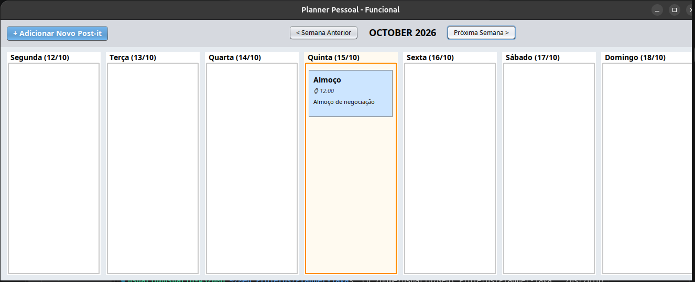

# Planner Pessoal - Quadro Kanban em Java 📅

Um aplicativo desktop de planejamento semanal construído em **Java**, focado em organização visual através de um quadro no estilo Kanban com "Post-its" coloridos. O projeto permite a gestão de tarefas baseadas em datas reais, com navegação entre semanas e persistência de dados.



## ✨ Funcionalidades

* **Quadro Semanal Dinâmico:** Visualização dividida em 7 colunas (Segunda a Domingo) com as datas exatas da semana atual.
* **Navegação Temporal:** Botões para avançar e retroceder entre as semanas (meses e anos são atualizados automaticamente).
* **Destaque do Dia Atual:** A coluna correspondente ao dia de hoje recebe um destaque visual automático (borda laranja).
* **Post-its Personalizáveis:** Adição de tarefas contendo Título, Horário, Data, Descrição e Cor (Amarelo, Rosa, Azul ou Verde).
* **Persistência de Dados:** Todas as tarefas são salvas automaticamente em um banco de dados local. Se você fechar e abrir o programa, nada é perdido.
* **Interface Moderna:** Utilização do tema *Nimbus* do Java Swing para um visual mais limpo e arredondado.

## 🛠️ Tecnologias Utilizadas

* **Java (JDK):** Lógica principal e orientação a objetos.
* **Java Swing & AWT:** Construção da interface gráfica de usuário (GUI).
* **SQLite:** Banco de dados embutido para salvar as tarefas (`planner.db`).
* **JDBC (Java Database Connectivity):** Comunicação entre o código Java e o banco de dados.

## 🚀 Como Executar o Projeto

### Pré-requisitos
Você precisará ter o **Java Development Kit (JDK)** instalado na sua máquina e uma IDE (como VS Code, Eclipse ou IntelliJ).

### Dependências (Bibliotecas)
Para que o banco de dados funcione, é necessário adicionar dois arquivos `.jar` ao projeto: o driver do SQLite e a API de logs SLF4J. 

Se estiver usando Linux/Ubuntu ou um terminal compatível, você pode baixar as dependências diretamente criando uma pasta `lib` na raiz do projeto e rodando os comandos abaixo:

```bash
mkdir lib
cd lib
wget [https://github.com/xerial/sqlite-jdbc/releases/download/3.45.1.0/sqlite-jdbc-3.45.1.0.jar](https://github.com/xerial/sqlite-jdbc/releases/download/3.45.1.0/sqlite-jdbc-3.45.1.0.jar)
wget [https://repo1.maven.org/maven2/org/slf4j/slf4j-api/2.0.9/slf4j-api-2.0.9.jar](https://repo1.maven.org/maven2/org/slf4j/slf4j-api/2.0.9/slf4j-api-2.0.9.jar)
```

### Passos para rodar no VS Code:
1. Clone este repositório ou baixe os arquivos.
2. Crie uma pasta chamada `lib` na raiz do projeto e coloque os arquivos `.jar` baixados dentro dela.
3. Coloque os códigos-fonte (`Database.java`, `PlannerVisual.java`, `Tarefa.java`) dentro da pasta `src`.
4. No VS Code, expanda a aba **Java Projects** > **Referenced Libraries**, clique no botão `+` e selecione os dois arquivos `.jar` da pasta `lib`.
5. Abra o arquivo `PlannerVisual.java` e clique em **Run**.

## 📂 Estrutura do Código

* **`Tarefa.java`**: A classe de modelo que define o que é uma tarefa (ID, Título, Data, Horário, Descrição, Cor).
* **`Database.java`**: Responsável por inicializar o banco SQLite (`planner.db`) e executar as queries de inserção e busca (SQL).
* **`PlannerVisual.java`**: Classe principal que desenha a tela usando Swing, gerencia os eventos de clique e controla o fluxo do tempo (LocalDate).